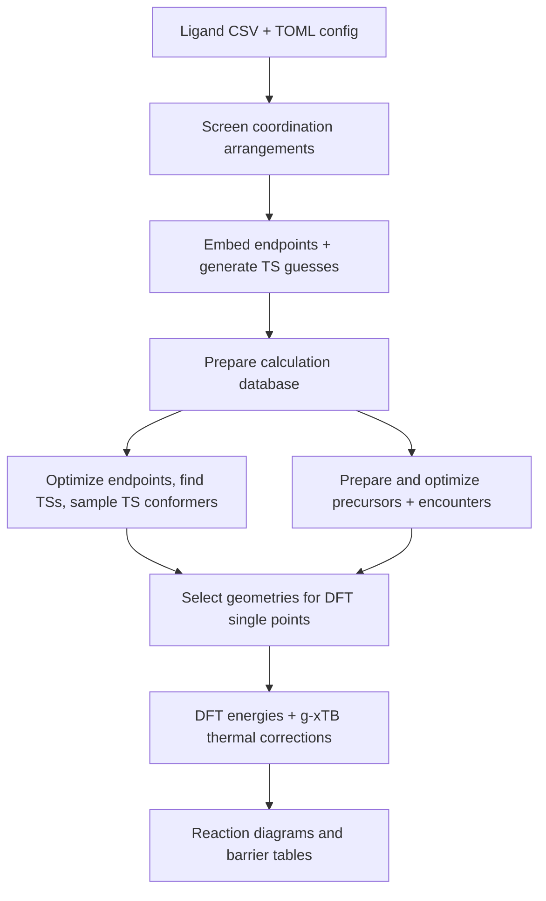
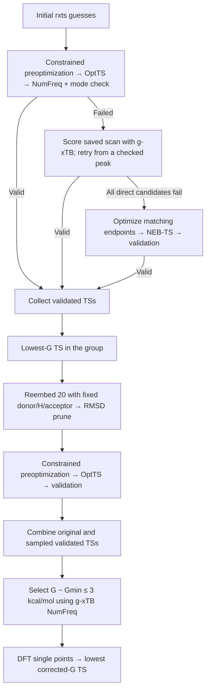

# rxflow

Transition-metal reaction screening, conformational sampling and validated TS
searches with rxembed, rxts, g-xTB and ORCA. Slurm runs the calculations; SQLite
records their progress; a notebook presents the reaction profiles.

## Workflow



`submit` schedules this chain automatically. The DFT submission waits for both
worker arrays to finish. `resume` reuses the prepared run and completed results.

| Stage | Default behavior |
| --- | --- |
| Coordination screening | One geometry per arrangement; retain within 20 kcal/mol of the lowest g-xTB electronic energy |
| Reaction endpoints | Request 20 conformers each; prune, optimize and run separate NumFreq |
| Initial TS guesses | Coembed 10 pairs; use up to 5 with the lowest TS RMSDs for rxts scans |
| TS conformational sampling | Reembed the group's lowest validated TS into 20 conformers with donor/H/acceptor fixed |
| Pruning | Prism heavy-atom RMSD, 0.5 Å; coembedded pairs remain unpruned |
| DFT selection | Each minimum's lowest-G conformer; all validated TSs within 3 kcal/mol of their group's lowest NumFreq Gibbs energy |

A TS group is one **ligand / reaction pair / seating**. Requested conformer counts
are embedding budgets; pruning can leave fewer calculations.

## Install and configure

Python 3.13, a Fortran compiler and BLAS/LAPACK are needed for the Python
installation and GFN-FF build. Install the pinned dependencies:

```sh
git clone https://github.com/HenryTeahan/rxflow.git
cd rxflow
uv sync --locked
source .venv/bin/activate
```

Load your cluster's ORCA/MPI environment and provide executable paths:

```sh
export ORCA_EXE=/path/to/orca
export XTB_EXE=/path/to/gxtb-enabled/xtb
export ORCA_EXTERNAL_TOOLS=/path/to/oet_gxtb_alpb
```

Copy `hpc.toml` to a run-specific config and edit its paths:

```sh
cp hpc.toml my_run.toml
```

```toml
[paths]
ligands_csv = "ligands.csv"
source = "my_run_seeds"
results = "my_run_results"

[sampling]
endpoint_conformers = 20
ts_conformers = 20
coembed_conformers = 10
ts_candidates = 5
prune_rmsd = 0.5
seed = 12345
```

Keep the remaining sections from `hpc.toml`, including the ORCA and MPI paths.
Paths are relative to the config file. A new run needs unused seed/results paths.
The CSV requires `ID`, `ligand_smiles`, `substrate`, `metal_geom`, `denticity`,
and either `metal` or `central_metal`.

## Start or resume

Start from the CSV:

```sh
rxflow --config my_run.toml submit --workers 100 --partition kemi1
```

Resume an existing run:

```sh
rxflow --config my_run.toml resume --workers 100 --partition kemi1
```

Use your cluster's partition and add `--account YOUR_ACCOUNT` if required.
Submission prints the Slurm job IDs and exports your executable environment.
Embedding and precursor preparation run on compute nodes.

| Work | Default allocation |
| --- | --- |
| Reaction and precursor workers | 100 workers per array; 1 CPU and 2 GB each |
| Precursor/encounter sampling | 10 conformers per species before pruning; controlled by `--conformers` |
| DFT single points | Up to 10 workers; 4 CPUs and 8 GB each |

`--workers` changes the reaction/precursor array sizes. `[calculation]` controls
their per-worker resources; `[singlepoint]` controls DFT resources.

## TS search and selection



Minima require **zero imaginary frequencies**. TSs require **exactly one**, with
graphRC confirming that donor, transferring H and acceptor participate in the
mode. Once the initial searches finish, TS sampling runs once per group; its
original successful TS stays available.
Sampled TSs use the direct preoptimization/OptTS sequence without scan/NEB recovery.

ORCA optimizations and NumFreq use g-xTB/ALPB(water). DFT single
points use **PBE0/def2-TZVP-D4/SMD(water)**, with each geometry's own correction:

```text
G(corrected) = E(DFT) + G(g-xTB NumFreq) − E(g-xTB NumFreq)
```

## Monitor and recover

```sh
squeue -u "$USER"
rxflow --config my_run.toml status
rxflow --config my_run.toml precursors status
rxflow --config my_run.toml singlepoint status
```

Slurm logs go in `logs/` beside the config file, created automatically before
submission: `sampling-*.out`, `orca-*.out`, `precursors-*.out` and
`singlepoint-*.out`, with matching `.err` files for stderr. Preparation and
acid/base jobs use the same folder.

Stop a row's previous worker before retrying it. Reset the appropriate queue,
then submit its workers again:

| Task | Reset command |
| --- | --- |
| One reaction job or interrupted TS sampling task | `rxflow --config my_run.toml retry --id ID` |
| Failed TS calculation/sampling tasks | `rxflow --config my_run.toml retry-ts` |
| One precursor | `rxflow --config my_run.toml precursors retry --id ID` |
| One encounter | `rxflow --config my_run.toml precursors retry --encounters --id ID` |
| One DFT single point | `rxflow --config my_run.toml singlepoint retry --id ID` |

Use `resume` after reaction/precursor resets, or `singlepoint resume` after DFT
resets. Failed rows are not retried automatically. See the
[reference guide](docs/workflow-reference.md#recovery-and-individual-stages) for
sampling failures, mode audits and unsatisfied Slurm dependencies.

## Acid/base references and results

For the full protonation/association diagram, run the separate acid/base workflow
once the reaction database exists:

```sh
rxflow --config my_run.toml acid-base submit --workers 20 --partition kemi1
rxflow --config my_run.toml acid-base status
```

It calculates shared acetic acid/acetate references and the run's protonated
bound reactants. After those jobs finish, refresh DFT selection:

```sh
rxflow --config my_run.toml singlepoint submit --workers 10 --partition kemi1
```

Open the results notebook, set `DB_PATH` to your run's `workflow.sqlite`, and run
all cells:

```sh
jupyter lab reaction_diagrams.ipynb
```

`ENERGY_MODE = "auto"` uses g-xTB energies until every selected conformer has its
DFT result, then switches the whole diagram to corrected energies. Missing
reference levels remain visible as gaps. Shared references live in `solution_references/`.

| File in the results directory | Contents |
| --- | --- |
| `workflow.sqlite` | Reaction endpoints, TS searches and TS sampling |
| `precursors.sqlite`, `encounters.sqlite` | Precursor and encounter calculations |
| `acid_base.sqlite` | Protonated bound reactants |
| `singlepoints.sqlite` | DFT results and source provenance |
| `ligand_XX/` | Geometries, ORCA inputs/outputs, scans and sampling reports |

Keep both seeds and results for recovery. Completed geometries and matching DFT
calculations are reused when you resume or prepare additional work.

## Repository layout

```text
rxflow/
├── src/                     Runtime modules and command entry points
├── hpc.toml, ligands.csv     Example configuration and inputs
├── reaction_diagrams.ipynb  Results notebook
├── tests/                   Regression suite and CSV fixtures
├── scripts/                 Manual Slurm submission templates
├── experiments/             Local investigation scripts and scratch work
├── logs/                    Slurm stdout and stderr (ignored by Git)
├── docs/                    Protocol and architecture reference
└── legacy/                  Historical workflow reference
```

Install the project with `uv sync --locked` after changing the source layout.
The editable install makes the modules in `src/` available to the CLI, tests,
notebook and Slurm workers; existing `rxflow` and `python -m hpc_workflow`
commands work from the repository root.

Run the tests from the repository root after activating the environment:

```sh
python -m unittest discover -s tests -t .
python -m unittest tests.test_hpc_workflow
```

The second command runs one test module. The suite uses temporary calculation
directories and mocked external calculations; it does not submit Slurm jobs.

The normal `rxflow submit` command builds the Slurm chain automatically. For
manual submission, run `sbatch scripts/hpc_sample.sbatch my_run.toml` or
`sbatch scripts/hpc_worker.sbatch my_run.toml` from the repository root after
ensuring the log directory exists with `mkdir -p logs`.

## Further reference

- [Protocol, queue details and advanced commands](docs/workflow-reference.md)
- [Architecture and development guidance](docs/architecture.md)
- [Local exploration and energy diagrams](docs/workflow-reference.md#notebooks-and-local-exploration)
